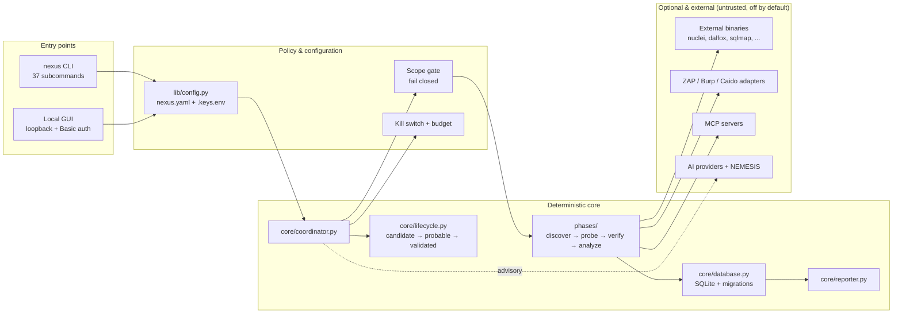

# NEXUS

**Authorized security testing — from reconnaissance to a submission-ready report.**

[](https://github.com/0xShadowVoid/NEXUS_FRAMEWORK/actions/workflows/ci.yml)
[](VERSION)
[](pyproject.toml)
[](LICENSE)

NEXUS is a local-first Python framework for **legally authorized** bug-bounty and
penetration-testing work. It runs a deterministic recon → probe → verify → analyze pipeline,
collects evidence, filters false positives, detects vulnerability chains, and renders
Markdown/SARIF/HTML reports — with scope enforced in code before every request and every
external-tool handoff.

> **Authorization is the entry condition.** Only test systems you own or are explicitly
> permitted to test. The framework enforces technical scope; it cannot grant legal permission.

---

## Why NEXUS

| Principle | What it means in practice |
|---|---|
| **Scope is law** | `in_scope` is the only authority; `out_of_scope` always wins. Every target is re-validated before each external-tool handoff and on every HTTP redirect hop. Malformed input and missing scope fail **closed**. |
| **Detection + PoC only** | The payload guard blocks destructive SQL, reverse shells, download-and-execute chains, and webshells. NEXUS proves a bug exists; it does not extract data or persist access. |
| **Deterministic core** | Every phase works with **no AI key**. AI/NEMESIS is advisory and can suggest — it can never validate a finding. |
| **Evidence first** | Findings carry tool/source/phase provenance, lifecycle transitions, and sanitized evidence. Reports are built from that record, not from model output. |
| **Offline-first tests** | The default suite contacts no live external system and needs no credentials. Live integrations are marked `unverified` where no offline fixture can exist. |
| **Honest status** | [SUPPORT_STATUS.md](docs/SUPPORT_STATUS.md) is the single authoritative map of what is supported, partial, unverified, or unavailable. |

**At a glance:** Python 3.11+ · Windows/Linux/macOS · SQLite · 37 CLI subcommands · default
suite **1081 passed, 11 skipped** · Docker image available · no mandatory hosted service.

---

## Quick start

### 1. Install

```powershell
git clone https://github.com/0xShadowVoid/NEXUS_FRAMEWORK.git
cd NEXUS_FRAMEWORK

python -m venv venv
.\venv\Scripts\Activate.ps1        # Windows
# source venv/bin/activate         # Linux / macOS

pip install --upgrade pip
pip install .
```

Wheel, Docker, and air-gapped installs: [INSTALLATION.md](docs/INSTALLATION.md).

### 2. Verify

```powershell
python -m nexus --version          # NEXUS 2.0.2 "Apex"
python -m nexus doctor             # environment, config, scope, database, tools
python -m nexus check-tools        # optional external binaries found on PATH
```

Missing external tools are **not** an error — affected steps report `skipped` and the
deterministic pipeline continues. See [TOOLS_REFERENCE.md](docs/TOOLS_REFERENCE.md).

### 3. Explore offline (no target, no keys, no external tools)

```powershell
python -m nexus self-scan                  # committed-secret scan (JSON summary)
python -m nexus mcp --mock --tools         # MCP client, in-memory fake server
python -m nexus zap --mock --capabilities  # ZAP adapter capabilities, no live ZAP
python -m nexus burp --mock --capabilities # Burp adapter capabilities
python -m nexus caido --mock --capabilities# Caido adapter capabilities
python -m nexus ai-providers               # provider capability matrix
```

### 4. Run your first **authorized** scan

Declare the target and its scope in `config/nexus.yaml` (only hosts you may test):

```yaml
targets:
  lab.local:
    intensity: quick-scan
    rate_limit: "50/minute"
    in_scope: [lab.local, 127.0.0.1]
    out_of_scope: []
```

Then run recon first, and a light scan when you are ready:

```powershell
python -m nexus hunt lab.local --discover-only   # recon only, no active probing
python -m nexus hunt lab.local                   # core pipeline
```

### 5. Read the results

```powershell
python -m nexus draft 1                  # submission draft for finding #1
python -m nexus export lab.local --format sarif
```

Artifacts land in `results/<domain>-<platform>-<type>-<scope>-<date>-<time>/`; findings and
evidence live in `nexus.db`. Format reference:
[REPORTS_AND_DATABASE.md](docs/REPORTS_AND_DATABASE.md).

---

## How it works



Solid arrows are execution flow; the dashed arrow is advisory AI. Everything in the optional
group is treated as untrusted data and cannot change NEXUS configuration. Full component map,
trust boundaries and repository layout: [ARCHITECTURE.md](docs/ARCHITECTURE.md).

### The core pipeline

| # | Phase | What it does |
|---|---|---|
| 1 | **DISCOVER** | Subdomains, URLs, tech fingerprinting, dorking — builds the attack surface |
| 2 | **PROBE** | Detection and PoC testing through scope-checked tool runners |
| 3 | **VERIFY** | Deterministic confirmation; fake or encoded reflections are disproved |
| 4 | **ANALYZE** | Dedup, severity, false-positive filtering, chain detection, persistence |
| 5 | **REPORT** | Markdown report, drafts, and SARIF/HTML/JSON/CSV exports |

Optional cycles (`authn`, `authz`, `takeover`, `network`, `cloud`, `intel`) are gated by
profile, scope kind, or explicit enablement. See [PHASES.md](docs/PHASES.md).

---

## Integrations

Everything below is **disabled by default** and requires explicit configuration. The adapter
still passes NEXUS scope, authorization, SSRF, budget, and redaction controls.

| Integration | Direction | Status |
|---|---|---|
| **OWASP ZAP** | Passive/active scan via JSON REST API | Adapter shipped; live use `unverified` (mock tested) |
| **Burp Suite Professional** | Crawl + audit via Pro REST API | Adapter shipped; live use `unverified` (mock tested) |
| **Caido** | Read-only findings + HTTP history via GraphQL | Adapter shipped; live use `unverified` (mock tested) |
| **MCP** | Client for external MCP tool servers (stdio / Streamable HTTP) | Supported offline; third-party servers `unverified` |
| **AI providers** | OpenAI-compatible HTTP (OpenAI, GLM, DeepSeek, Gemini, Kimi, OpenRouter, custom, Ollama) | Supported offline; live APIs `unverified` |
| **Cloud posture** | Read-only AWS/Azure/GCP checks | Partial; needs credentials |
| **C2 bot** | Discord/Telegram control | Partial; needs bot tokens |
| **Browser automation** | Playwright, opt-in | Partial; opt-in real-browser CI job |

Details: [ADAPTERS.md](docs/ADAPTERS.md) · [MCP.md](docs/MCP.md) ·
[AI_AND_NEMESIS.md](docs/AI_AND_NEMESIS.md) · [SKILLS_REFERENCE.md](docs/SKILLS_REFERENCE.md).

---

## Security model

- **Scope** — exact hosts only; wildcards are anchored; IP literals need an explicit entry or
  CIDR; ports are ignored; malformed input fails closed.
- **Handoff** — external tools receive only scope-filtered URL/host lists and are spawned as
  argv lists (no shell).
- **Payloads** — destructive SQL, shells, download-and-execute, and webshells are rejected
  recursively, including inside structured MCP arguments.
- **Persistence** — `core/sanitizer.py` is the single write choke point; credentials, tokens,
  and banned keys are redacted before evidence or reports are stored.
- **GUI** — loopback-only by default, Basic auth required, and fail-closed (HTTP 503) when
  `NEXUS_GUI_USER` / `NEXUS_GUI_PASS` are unset.
- **Secrets** — never committed; `self-scan` / `secretscan` and the optional pre-commit hook
  detect leaks.

Read the enforcement matrix in [SECURITY.md](docs/SECURITY.md) and the threat model in
[SECURITY_MODEL.md](docs/SECURITY_MODEL.md). To report a vulnerability in NEXUS itself, follow
the root [SECURITY.md](SECURITY.md) policy (no public exploit details).

---

## Commands

The CLI exposes **37 subcommands**. Highlights:

| Area | Commands |
|---|---|
| Scanning | `hunt`, `batch`, `hunt-schedule`, `hunt-new`, `serve` |
| Findings | `verify`, `reject`, `draft`, `diff`, `export`, `import` |
| Intelligence | `cve-update`, `cve-scan`, `monitor`, `scope-sync` |
| Operations | `doctor`, `check-tools`, `self-scan`, `secretscan`, `hooks`, `retention`, `update` |
| Integrations | `zap`, `burp`, `caido`, `mcp`, `c2`, `openapi`, `graphql` |
| AI / agents | `agent`, `team`, `ai-keys`, `ai-providers`, `ai-runtime`, `ai-set-key` |
| Other | `dork`, `gui` |

Full flags and exit behavior: [CLI_REFERENCE.md](docs/CLI_REFERENCE.md). Configuration keys and
defaults: [CONFIGURATION.md](docs/CONFIGURATION.md).

---

## Documentation

Start with [docs/INDEX.md](docs/INDEX.md) — it routes both audiences:

| I want to… | Read |
|---|---|
| Learn the concepts from zero | [BEGINNER_GUIDE.md](docs/BEGINNER_GUIDE.md) |
| Do a first scan step by step | [GETTING_STARTED.md](docs/GETTING_STARTED.md) |
| Look up a command or config key | [CLI_REFERENCE.md](docs/CLI_REFERENCE.md) · [CONFIGURATION.md](docs/CONFIGURATION.md) |
| Deploy, schedule, back up | [NEXUS_OPERATIONS_GUIDE.md](docs/NEXUS_OPERATIONS_GUIDE.md) · [WORKFLOWS.md](docs/WORKFLOWS.md) |
| Understand the internals | [ARCHITECTURE.md](docs/ARCHITECTURE.md) · [PHASES.md](docs/PHASES.md) |
| Review security controls | [SECURITY.md](docs/SECURITY.md) · [SECURITY_MODEL.md](docs/SECURITY_MODEL.md) |
| Know what is actually supported | [SUPPORT_STATUS.md](docs/SUPPORT_STATUS.md) |
| Contribute or run tests | [CONTRIBUTING.md](docs/CONTRIBUTING.md) · [TESTING.md](docs/TESTING.md) |

---

## Development & tests

```powershell
pip install .[dev]
python -m pytest tests -q
```

The default suite is offline and deterministic (no network, no live credentials). The opt-in
real-browser job is separate:

```powershell
python scripts/run_browser_tests.py
```

See [TESTING.md](docs/TESTING.md) for the test layout, browser prerequisites, and CI jobs, and
[CONTRIBUTING.md](docs/CONTRIBUTING.md) for conventions and the pull-request checklist.

## Project status

- **Version:** 2.0.2 “Apex” (`VERSION`, `pyproject.toml`).
- **Stability:** assessed **stable for maintenance** — see
  [docs/releases/NEXUS_STABILITY_REPORT.md](docs/releases/NEXUS_STABILITY_REPORT.md).
- **Readiness evidence:** [RELEASE_READINESS.md](docs/RELEASE_READINESS.md) ·
  [SUPPORT_STATUS.md](docs/SUPPORT_STATUS.md).
- **Roadmap history:** [ROADMAP.md](docs/ROADMAP.md) (historical) and
  [FEATURE_MAP.md](docs/FEATURE_MAP.md).

## License & acknowledgements

Released under the [MIT License](LICENSE). NEXUS orchestrates open-source security tools and
does not bundle them; each tool keeps its own license and rules of engagement. Built on the
work of the security community — use it responsibly and only where you are authorized.
