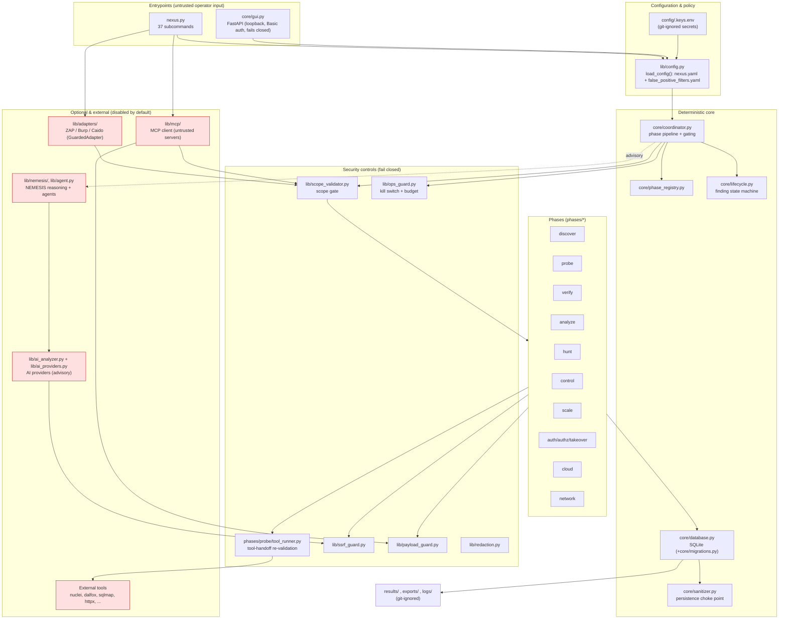
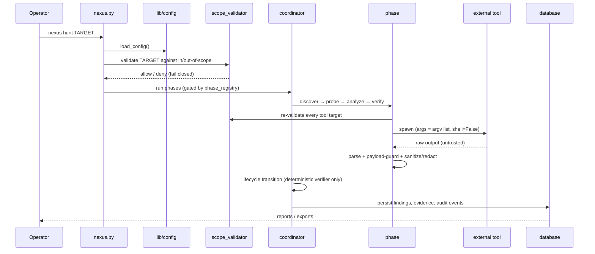

# Architecture

NEXUS is a modular, offline-first Python framework. This page shows the runtime
components, the trust boundaries, and the on-disk layout. For the enforcement
detail behind each boundary see [SECURITY.md](SECURITY.md); for feature status
see [SUPPORT_STATUS.md](SUPPORT_STATUS.md).

## Component & data-flow diagram



**Reading the diagram.** Solid arrows are control/execution flow; the dashed
arrow is the advisory AI path (it can suggest but never validates). Everything in
the red "Optional & external" group is **untrusted**: its output is parsed,
bounds-checked and redacted, and it can never write NEXUS configuration. The
`GUARDS` group is applied *before* any external handoff and again on return.

## Scan data flow



## Trust boundaries

| Boundary | Control | Where |
|---|---|---|
| Operator input → core | argparse validation, `ConfigError` on bad config | `nexus.py`, `lib/config.py` |
| Core → target network | scope gate, SSRF guard, kill switch, budget | `lib/scope_validator.py`, `lib/ssrf_guard.py`, `lib/ops_guard.py` |
| Core → external tool | per-target re-validation, argv-list spawn (no shell) | `phases/probe/tool_runner.py` |
| External tool/adapter/MCP → core | tolerant parsing, recursive payload guard, bounded results, redaction | `lib/payload_guard.py`, `core/sanitizer.py`, `lib/redaction.py` |
| AI provider → core | responses treated as untrusted JSON; advisory only, never validates a finding | `lib/ai_analyzer.py`, `core/lifecycle.py` |
| Any → persistence | single choke point: sanitize + redact on write | `core/database.py` (`core/sanitizer.py`) |
| Package/repo → release | self-scan + secret scanning of staged content and history | `lib/selfscan.py`, `scripts/hooks/pre-commit` |

## Repository structure

```
NEXUS_FRAMEWORK/
├─ nexus.py                  # CLI entrypoint (37 subcommands) + main()
├─ pyproject.toml            # packaging, deps, console script `nexus`
├─ requirements.txt          # runtime deps (mirror of pyproject)
├─ VERSION                   # 2.0.1 ("Apex")
├─ Dockerfile / docker-compose.yml
├─ config/                   # nexus.yaml, false_positive_filters.yaml (required),
│                            # tools.yaml, methodologies.yaml, .keys.env.example
├─ core/                     # coordinator, database, migrations, lifecycle,
│                            # sanitizer, reporter, gui, analyzer, exporter/importer
├─ phases/                   # discover probe verify analyze hunt control scale
│                            # auth cloud network takeover
├─ lib/
│  ├─ adapters/              # ZAP / Burp / Caido adapter framework (GuardedAdapter)
│  ├─ mcp/                   # MCP client + tool gateway (untrusted servers)
│  └─ nemesis/               # NEMESIS runtime, MCP server side
├─ skills/                   # NEMESIS methodology playbooks
├─ templates/                # report templates (per platform)
├─ scripts/hooks/pre-commit  # secret-scan hook
├─ docs/                     # all documentation (see SUPPORT_STATUS.md inventory)
├─ tests/                    # unit / integration / e2e (offline, deterministic)
├─ results/ exports/ logs/ browser-artifacts/   # git-ignored output
└─ .github/workflows/ci.yml  # CI: pytest+coverage, self-scan, secret scan, hook lint
```

## Design principles

1. **Deterministic core, optional AI.** Every phase runs with no AI provider; the
   AI/NEMESIS layer is advisory and strictly additive.
2. **Fail closed by default.** Missing scope context, unknown config, unsupported
   provider, malformed input and blocked destinations deny rather than proceed.
3. **One choke point.** All persistence passes through the DB layer's sanitize +
   redact step.
4. **Untrusted externals.** Tools, adapters, MCP servers and AI replies are data,
   never instruction, and can never mutate NEXUS configuration.
5. **Offline-first tests.** The suite is deterministic and contacts no live
   external system (see [SUPPORT_STATUS.md](SUPPORT_STATUS.md) for what is
   therefore `unverified`).
