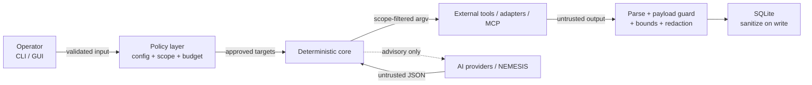

# Security Model

This page is the **threat model and trust-boundary reference** for NEXUS. It explains what the
framework protects, what it assumes, and where each control lives in code.

- Enforcement matrix and safe-use policy: [SECURITY.md](SECURITY.md)
- Support/verification status: [SUPPORT_STATUS.md](SUPPORT_STATUS.md)
- Vulnerability disclosure for NEXUS itself: [../SECURITY.md](../SECURITY.md)

## 1. Scope of this model

NEXUS is a **single-operator, local-first** tool. It orchestrates security tooling on a machine
the operator controls. It is **not** a multi-tenant service, a sandbox for hostile binaries, or
a substitute for legal authorization.

### Assets

| Asset | Why it matters |
|---|---|
| Authorization scope (`in_scope` / `out_of_scope`) | Prevents traffic to systems the operator may not test |
| Evidence, findings, reports | May contain sensitive target data or secrets |
| Credentials (`config/.keys.env`, env vars) | API keys, tokens, session cookies |
| Local database (`nexus.db`) | Scan history, evidence, audit trail |
| The host and its network position | A compromised tool could affect the operator's machine |

### Actors and inputs

| Actor / input | Trust |
|---|---|
| Operator (CLI, GUI) | Trusted to be authorized, but input is still validated |
| Target responses, HTML, tool output | **Untrusted** |
| External tools and their parsers | **Untrusted output**, spawned without a shell |
| Adapter endpoints (ZAP/Burp/Caido) | **Untrusted output**, authenticated, scope-checked |
| MCP servers and tool metadata/results | **Untrusted**, default-deny allowlist |
| AI provider responses | **Untrusted**, advisory only |
| Page content in browser automation | **Untrusted** |
| Local filesystem / config / database | Trusted only as far as the local machine is |

### Non-goals

- Protecting against a malicious local administrator or a compromised host.
- Isolating mutually untrusted operators or tenants.
- Sandboxing third-party binaries (NEXUS governs what it hands them, not their internals).
- Guaranteeing a target's safety or a program's rules — authorization remains the operator's
  responsibility.

## 2. Trust boundaries

| Boundary | Control | Location |
|---|---|---|
| Operator → core | argparse validation; `ConfigError` on malformed config | `nexus.py`, `lib/config.py` |
| Core → target network | scope gate, SSRF guard, kill switch, request budget | `lib/scope_validator.py`, `lib/ssrf_guard.py`, `lib/ops_guard.py` |
| Core → external tool | per-target re-validation; argv-list spawn (`shell=False`) | `phases/probe/tool_runner.py` |
| Core → adapter | `GuardedAdapter`: scope, authorization, budget, SSRF, redaction | `lib/adapters/base.py` |
| Core → MCP server | enablement, allowlist, schema check, payload guard, scope, bounds | `lib/mcp/`, `lib/nemesis/mcp.py` |
| External output → core | tolerant parsing, recursive payload guard, length caps, redaction | `lib/payload_guard.py`, `lib/redaction.py`, `core/sanitizer.py` |
| AI → core | defensive JSON parsing; advisory only; cannot validate a finding | `lib/ai_analyzer.py`, `core/lifecycle.py` |
| Any → persistence | single choke point: sanitize + redact on write | `core/database.py` (`insert_evidence`) |

## 3. Control catalog

### Scope and authorization

- `lib/scope_validator.py` is the authority. `out_of_scope` always wins over `in_scope`.
- Matching is **exact-host** by default. `*.example.com` is an **anchored** wildcard covering the
  apex and subdomains, never `example.com.attacker.test`.
- Ports are ignored for host matching; restrict ports separately in the network phase.
- IP literals require an exact entry or CIDR. Private/loopback/link-local/metadata addresses
  additionally require the network phase's explicit grants.
- Malformed entries, userinfo tricks, backslashes, and bare paths fail closed.
- The GUI derives its authorization boundary **only** from the configured `targets:` scope; a
  request cannot define its own boundary.
- True for NEXUS-originated traffic and for every host/URL handed to an external tool. A
  third-party binary's internal behaviour is outside NEXUS's control — keep scope precise.

### SSRF and redirects

- `lib/ssrf_guard.py` is applied to outbound HTTP, AI/provider endpoints, adapter endpoints and
  URLs, and MCP endpoints and URL arguments.
- Redirect chains are re-checked; cloud-metadata hosts and paths are always blocked.
- Adapter endpoints may allow loopback/private destinations (`local_ok=True`) for a local
  instance, but metadata addresses remain blocked.

### Destructive payloads

- `lib/payload_guard.py` rejects destructive SQL, reverse shells, download-and-execute chains,
  and webshells.
- For MCP, validation runs **recursively** over all string arguments
  (`validate_payload_tree`), including values nested inside objects and arrays. JSON Schema is
  treated as untrusted metadata, **not** as the safety boundary.
- The product boundary is detection + proof-of-concept only. NEXUS does not extract data,
  modify targets, establish persistence, or deploy backdoors.

### Kill switch and budgets

- `lib/ops_guard.py` provides the kill switch and request budget.
- Phase cancellation and per-tool timeouts are honoured; cancelled scans are recorded `partial`
  rather than silently dropped.

### Finding lifecycle

- `core/lifecycle.py` enforces `candidate → probable → validated | rejected`.
- Promotion to `validated` requires deterministic verification. AI/NEMESIS may suggest, but it
  cannot validate.

### Persistence and redaction

- `core/sanitizer.py` is the single persistence choke point for evidence and reports.
- Secret headers, bearer/API-key tokens, and banned keys are redacted **before** write.
- Credentials are read from `config/.keys.env` / the environment (git-ignored) and are masked in
  logs, `repr`, key listings, and error messages.
- Database migrations are additive; opening an older database upgrades it in place.

### Local GUI

- `core/gui.py` is loopback-only by default and refuses a non-loopback host unless explicitly
  allowed.
- Basic auth is required; missing `NEXUS_GUI_USER` / `NEXUS_GUI_PASS` fails closed (HTTP 503).
- Targets submitted through the GUI are authorized against the configured scope; an uncovered
  target is rejected (HTTP 403).

### Adapters (ZAP / Burp / Caido)

- Disabled by default and authenticated via environment variables (never inline keys).
- Active/intrusive jobs require both a policy master switch (`allow_active_scan` / `allow_scan`)
  and per-run `--authorize-active`.
- Caido is read-only; it never starts a job.
- Tool output is untrusted: free-text fields are redacted and length-capped before becoming a
  finding or evidence row.

### MCP

- Disabled by default at the top-level `mcp.enabled` switch (`nemesis.mcp` is **not** the client
  switch), plus per-server opt-in.
- Per-server allowlist is default-deny; an empty `tools` list denies everything.
- stdio commands are argv lists with `shell=False`; remote endpoints pass SSRF and refuse
  redirects.
- Results are bounded and redacted. An MCP server can never write NEXUS configuration.

### AI and NEMESIS

- AI is optional; the deterministic core works with no key.
- Outbound AI traffic passes the SSRF guard; prompts exclude credentials and bulk evidence.
- Responses are parsed defensively and are advisory only.
- Agent actions run over a whitelist; arbitrary execution is not available.
- Browser automation is off by default; page content is always treated as untrusted.

### Cloud

- Read-only checks only.
- Identity is verified against a mandatory per-provider account allowlist **before any other API
  call**; an empty allowlist means zero calls.

### Secret hygiene and release

- `self-scan` / `secretscan` detect committed secrets in staged content, history, or the tree.
- The optional pre-commit hook (`hooks install`) blocks staged secrets.
- `config/.keys.env`, `nexus.db`, `results/`, `logs/`, and browser artifacts are git-ignored.

## 4. Fail-closed decisions

These must deny, not proceed:

- Missing, empty, or malformed scope context.
- Unknown/additional config that cannot be validated.
- Out-of-scope or malformed target, URL, IP, or wildcard.
- Blocked payload or blocked destination (including metadata addresses).
- Missing GUI credentials.
- MCP: unknown server/tool, empty allowlist, invalid schema, undeclared arguments, missing
  active approval.
- Cloud: empty account allowlist.
- Unsupported AI provider where validation is applied (`nemesis.agents`).
- A database write that cannot be sanitized.

## 5. Residual risks

| Risk | Notes / mitigation |
|---|---|
| Third-party tool internals | NEXUS controls handoff inputs, not a binary's own redirects or enumeration. Keep `in_scope` precise. |
| Unlisted domain self-scoping | Adapter CLI scope derives from `--domain`; an unlisted domain defaults `in_scope` to that domain (never siblings). Add an explicit `targets:` entry to restrict. |
| Live integrations `unverified` | ZAP/Burp/Caido/cloud/AI/MCP third-party behaviour is mock-tested offline; real-world behaviour is not guaranteed by the suite. |
| JSON Schema in MCP | Shallow validation only; the recursive payload guard is the real boundary. |
| AI prompt injection | Target/page content may contain instructions; responses are untrusted and never authorize actions. |
| Local host compromise | A malicious local admin can read config, keys, and evidence. Full-disk encryption and OS hygiene are the operator's responsibility. |
| Sensitive evidence on disk | `nexus.db`, `results/`, and `logs/` may contain target data; encrypt or delete them per policy. |
| Browser automation | Rendered content is untrusted; keep the feature off unless needed. |

## 6. Verification map

| Control area | Representative tests |
|---|---|
| Scope + handoff | `tests/unit/test_scope_validator.py`, `test_pass10_scope_handoff.py` |
| SSRF | `tests/unit/test_pass3b_ssrf.py` |
| Payload guard (recursive) | `tests/unit/test_payload_guard.py` |
| Lifecycle | `tests/unit/test_pass3b_lifecycle.py`, `test_verifier.py` |
| Sanitizer / redaction | `tests/unit/test_utils_and_sanitizer.py` |
| GUI authz / fail-closed | `tests/unit/test_pass7_gui.py`, `test_pass13_gui_authz.py` |
| MCP hardening | `tests/unit/test_pass28_mcp_client.py`, `test_pass29_mcp_hardening.py` |
| Adapters | `tests/unit/test_pass22_zap_adapter.py`, `test_pass26_burp_adapter.py`, `test_pass27_caido_adapter.py` |
| Secret scanning / hook | `tests/unit/test_pass24_precommit_secret_scan.py` |
| Boundary fuzzing | `tests/unit/test_fuzz_boundary.py` |
| Migrations / DB integrity | `tests/unit/test_pass30_integration_audit.py` |

Coverage gaps and their review are tracked in
[releases/NEXUS_STABILITY_REPORT.md](releases/NEXUS_STABILITY_REPORT.md). Uncovered branches are
predominantly defensive/error paths and live-I/O adapters, not missing authorization checks.
